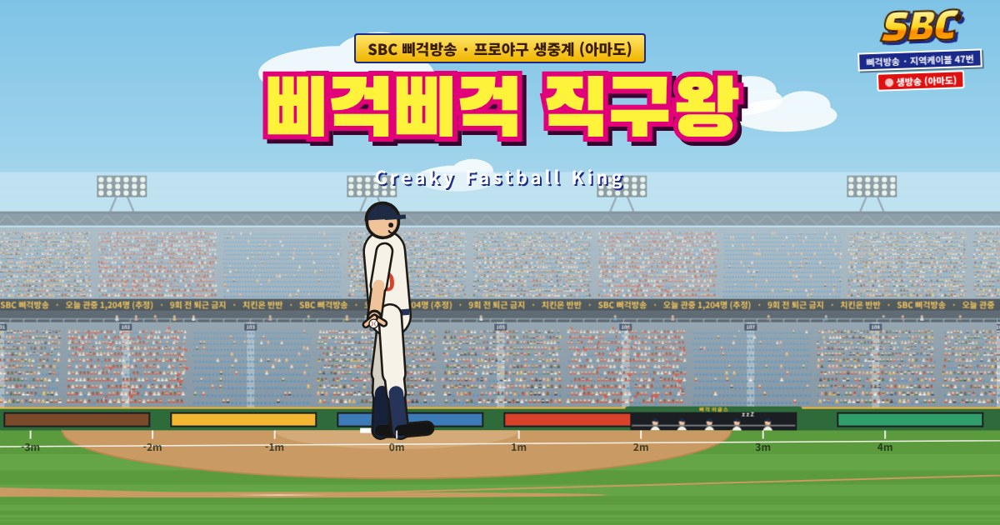

# 삐걱삐걱 직구왕 · Creaky Fastball King



**일부러 조작이 어려운 야구 투수 게임이에요.** 키보드로 투수의 관절을 하나씩 움직여 공을 던지고, 공이 날아간 거리가 점수예요.
가상의 지역 케이블 방송 **'SBC 삐걱방송'**이 중계하는 B급 세계관이에요.

▶ **플레이: https://creaky-fastball-king.vercel.app**

- 키보드 전용이에요. 휴대폰·태블릿에서는 안내 화면만 나와요.
- HTML 파일 하나로 돌아가요. 설치나 외부 접속이 필요 없어서, 파일을 내려받아 브라우저로 열어도 똑같이 플레이할 수 있어요.

## 조작법

| 키 | 하는 일 |
|---|---|
| `K` + `L` | 검지·중지로 공 쥐기. **둘 다 계속 누르고 있어야** 공이 손에 붙어 있어요. 떼는 순간 공이 나가요. |
| `Q` / `A` | 앞다리 들기 / 뒤로 차기 |
| `W` / `S` | 축발(뒷다리) 앞으로 / 뒤로 차기 |
| `E` / `D` | 어깨(팔) 던지는 방향으로 / 반대로 돌리기 |
| `U` / `J` | 팔꿈치 접기 / 펴기 |
| `Space` | 언제든 다시 하기 |
| `T` | 시작 화면에서 투구 교실(튜토리얼) |
| `M` / `G` | 소리 켜고 끄기 / 관절 표시 |

20초 안에 던지세요. 넘어져도 던질 수 있어요. 처음이라면 **투구 교실**부터 해 보세요.

## 이렇게 만들었어요

- AI(Claude Code)와 대화하면서 만들고 다듬었어요. 다른 AI(Manus, ChatGPT)의 검토 의견도 받아 반영했어요.
- 그림은 모두 코드로 그리고(canvas), 소리와 음악도 모두 코드로 합성해요(Web Audio). 이미지·음원 파일이 없어요.
- 게임 속 방송사, 구단, 선수, 광고는 **모두 가상**이에요. 실제와 관련이 없어요.
- Claude Code의 기능을 직접 써 보며 익히려고 만든 개인 프로젝트예요.

## 파일 구조

| 파일 | 내용 |
|---|---|
| `physics.js` | 투수 몸의 물리 (13개 관절의 Verlet 랙돌) |
| `logic_part.js` | 게임 진행, 입력, 판정, 칭호, 카메라, 화면 표시, 소리, 투구 교실 |
| `draw_part.js` | 캔버스 그리기 (인물, 야구장, 관중, 동네) |
| `template2.html` | HTML/CSS 껍데기 |
| `build.py`, `build_release.py`, `fontpack.py` | 위 파일과 폰트를 HTML 하나로 합치는 빌드 스크립트 |
| `site/` | 웹 배포용 완성본 (`site/index.html`) |
| `tests/` | 자동 테스트 (Playwright) |
| `fonts/` | 폰트 원본과 라이선스 |

## 직접 빌드하기

```bash
pip install playwright fonttools brotli   # node도 필요해요 (문법 검사)
python3 build_release.py                  # pitcher.html(확인용) + pitcher_release.html(출시용)
python3 tests/run_all.py --quick          # 기본 테스트
```

## 폰트 라이선스

게임 안에 쓰인 글자만 뽑아 넣은 폰트예요. 둘 다 [SIL Open Font License 1.1](https://openfontlicense.org)이에요.

- **Noto Sans KR** — Copyright 2014-2021 Adobe (Reserved Font Name 'Source'). 게임 안 이름 `CFK Sans`
- **Black Han Sans** — Copyright 2015 The Black Han Sans Project Authors. 게임 안 이름 `CFK Display`

자세한 내용과 원본 파일은 [`fonts/`](fonts/)에 있어요.

## 라이선스

코드는 [MIT 라이선스](LICENSE)예요. 출처(저작권 표시)만 남기면 자유롭게 쓰고, 고치고, 다시 배포할 수 있어요.
`fonts/`의 폰트와 HTML에 들어간 폰트는 MIT가 아니라 위의 SIL Open Font License 1.1을 따라요.
